 

  

**`> software engineer and student at finki. i build websites, saas products and apps for clients locally and globally.`**

personal site of jovan "vanni" vasilevski. plain js, a pile of hand-written canvas effects, and everything drawn in 0/1.

 

  

<code>ohrid / skopje, mk</code> &nbsp;·&nbsp; <code>built in 0 and 1</code>

 

